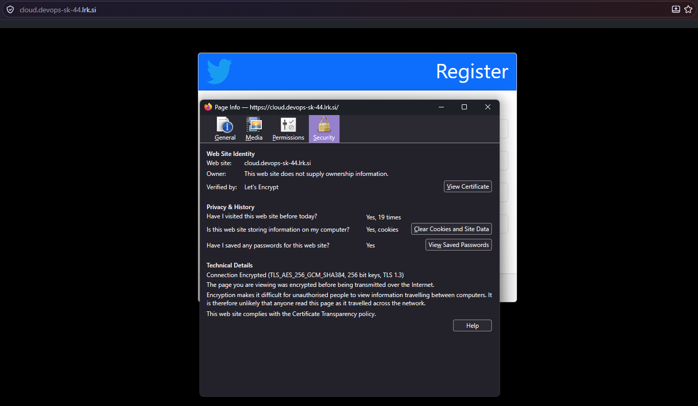
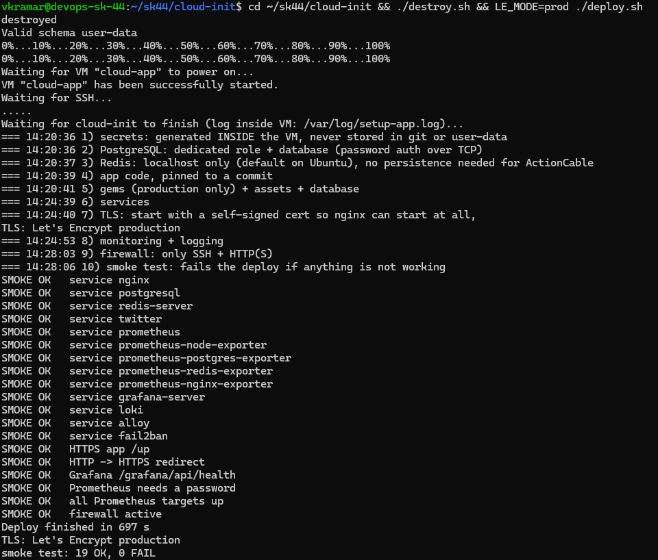
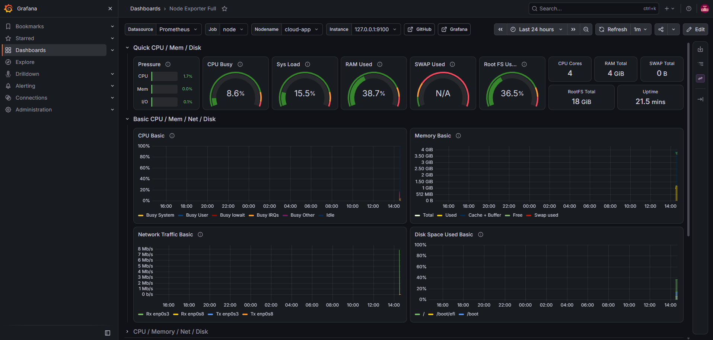
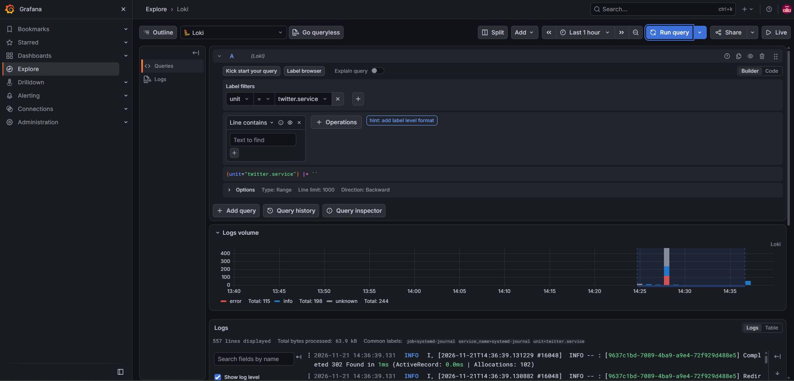

# Cloud-init verzija (Vid Kramar)

Ista Rails aplikacija kot v Vagrant verziji, le da jo **postavi cloud-init ob prvem zagonu** iz uradne Ubuntu 24.04 cloud slike. En ukaz (`./deploy.sh`) od nič ustvari VM, namesti celoten sklad, pridobi veljaven Let's Encrypt certifikat, postavi monitoring in na koncu vse sam preveri (smoke test).

Živa verzija: **https://cloud.devops-sk-44.lrk.si**

## 1. Arhitektura

```
internet ──► devops-sk-44 (javni IP) ── nginx router (../host-router)
               │  :80  po glavi Host   (Let's Encrypt HTTP-01, preusmeritev na HTTPS)
               │  :443 po SNI, TLS se NE dešifrira (certifikat in ključ ostaneta v VM-ju)
               ▼
            VirtualBox VM "cloud-app"  192.168.56.10  (host-only omrežje)
              nginx :443/:8443 ──► Puma (Rails) 127.0.0.1:3000 ──► PostgreSQL, Redis
              Prometheus + exporterji, Loki + Alloy, Grafana (vse samo na 127.0.0.1)
```

| Komponenta | Vloga |
|---|---|
| **nginx** | HTTPS, varnostne glave, statične datoteke (`/assets/`, 1 leto cache), reverse proxy, omejitev hitrosti |
| **Puma / Rails 7.1** | aplikacija, teče kot sistemski uporabnik `twitter` (brez shell-a) pod systemd |
| **PostgreSQL 16** | baza; lasten uporabnik z naključnim geslom, aplikacija ni administrator baze |
| **Redis** | ActionCable (websocketi), samo localhost |
| **Prometheus + node/postgres/redis/nginx exporter** | metrike, 7 dni hrambe |
| **Loki + Grafana Alloy** | centralni logi (systemd journal + nginx) |
| **Grafana** | grafi in iskanje po logih: `/grafana/` (dashboardi Node Exporter Full, PostgreSQL, Redis) |

Vse je nameščeno iz **apt** (Ubuntu repozitorij + uradni Grafana repozitorij).

## 2. Datoteke

| Datoteka | Kaj je |
|---|---|
| `prepare-image.sh` | enkratna priprava hosta: orodja, SSH ključ, prenos in **preverjanje SHA256** Ubuntu slike, pretvorba v VDI |
| `user-data.tmpl` | **glavna cloud-config datoteka** (paketi, uporabniki, datoteke, namestitvena skripta). Vsebuje samo oznake `__FQDN__`, `__SSH_PUBKEY__` …, nobenih skrivnosti |
| `meta-data` | identiteta instance (`instance-id`) |
| `network-config` | NAT (internet) + host-only `192.168.56.10` |
| `deploy.sh` | izpolni predlogo, preveri shemo (`cloud-init schema`), zgradi seed ISO, ustvari in zažene VM, čaka in izpisuje korake |
| `destroy.sh` | izbriše VM in njegov disk |
| `ssh.sh` | SSH v VM (`./ssh.sh 'ukaz'`) |
| `../host-router/setup-router.sh` | nginx router na hostu za obe verziji (cloud + vagrant) |

## 3. Uporaba

Predpogoji: Linux host z VirtualBoxom (testirano na Ubuntu 24.04, VirtualBox 7.0).

```bash
cd cloud-init
./prepare-image.sh                 # samo prvič
./deploy.sh                        # Let's Encrypt staging (privzeto, za testiranje)
LE_MODE=prod ./deploy.sh           # pravi certifikat (Let's Encrypt dovoli 5 na teden za isto domeno)
LE_MODE=off ./deploy.sh            # samo samopodpisan certifikat (npr. na prenosniku brez javne domene)
FQDN=moja.domena.si ./deploy.sh    # druga domena
./destroy.sh                       # pobriše VM
```

Router na hostu (enkrat; potrebuje `sudo`):
```bash
../host-router/setup-router.sh
```

Na koncu deploya se izpiše: čas, način TLS, rezultat smoke testa in prijavni podatki za Grafano/Prometheus (geslo se ustvari v VM-ju ob vsakem deployu).

## 4. Kako cloud-init teče (vrstni red)

1. **local / network:** cloud-init najde seed ISO (NoCloud), nastavi omrežje.
2. **init:** uporabniki in SSH ključi (`ssh_pwauth: false`: prijava samo s ključem).
3. **final:** `packages` (apt, slovenski mirror) → `write_files` z **`defer: true`** (zapisane šele po namestitvi paketov, da jih paketi ne povozijo in da mape že obstajajo) → `runcmd` požene `setup-app.sh`.

`setup-app.sh` (log: `/var/log/setup-app.log`, samo root):
1. skrivnosti (`SECRET_KEY_BASE`, geslo baze, geslo za monitoring) se ustvarijo **v VM-ju** z `openssl rand` → `/etc/twitter/env` (0640); nikoli niso v gitu, `user-data` ali logu (`set +x`)
2. PostgreSQL uporabnik + baza
3. Redis
4. koda aplikacije, **zaklenjena na commit** (`APP_COMMIT` v `deploy.sh`); popravek za Ruby 3.2 iz apt
5. `bundle install` (samo produkcija, `MAKE="make -j4"`), `assets:precompile`, `db:prepare`
6. systemd servis `twitter` (utrjen: `NoNewPrivileges`, `ProtectSystem`, `ProtectHome`, `PrivateTmp`)
7. TLS: najprej samopodpisan certifikat, nato `certbot` (HTTP-01); avtomatsko podaljševanje (`certbot.timer` + reload nginx)
8. monitoring + logging
9. požarni zid
10. **smoke test**: vsi servisi, HTTPS `/up`, HTTP→HTTPS, Grafana, Prometheus zahteva geslo, vse Prometheus tarče `up`, firewall. Če kaj pade, pade deploy.

## 5. Varnost

- **SSH:** samo ključ, brez gesla; fail2ban za SSH.
- **Najmanjši privilegiji:** aplikacija teče kot `twitter` (nologin), baza ima lastnega uporabnika, Postgres exporter ima samo `pg_monitor`.
- **Omrežje:** UFW privzeto zavrne vse; odprti so samo 22, 80, 443 (8443 samo iz host-only omrežja). Puma, baza, Redis, Prometheus, Grafana, Loki poslušajo **samo na 127.0.0.1**.
- **TLS:** veljaven Let's Encrypt certifikat, samo TLS 1.2/1.3, HSTS, `X-Content-Type-Options`, `X-Frame-Options`, `Referrer-Policy`, `server_tokens off`.
- **Pravi IP odjemalca:** router doda **PROXY protocol**, zato VM v logih in pri omejevanju vidi pravi IP obiskovalca, ne IP-ja routerja.
- **Brute force:** `limit_req` (aplikacija 10 zahtev/s, `/prometheus/` 10/min na IP → `429`); Grafana ima svojo zaščito prijave. Fail2ban za nginx namenoma ni uporabljen: ves promet pride v VM z IP-ja routerja, iptables blokada bi zaprla vse.
- **Monitoring:** Prometheus za basic auth, Grafana z lastno prijavo, brez registracije in anonimnega dostopa.
- **Posodobitve:** `unattended-upgrades`. Slika je preverjena s SHA256 od Ubuntuja.

## 6. Hitrost deploya

Merjeno z `./deploy.sh` na devops-sk-44 (4 vCPU, hkrati teče še Vagrant VM):

| Različica | Čas |
|---|---|
| samo aplikacija | ~590 s |
| + HTTPS + monitoring | 1036 s |
| + `MAKE="make -j4"` (C-razširitve, npr. `sassc`, na vseh jedrih) + slovenski apt mirror | **~750 s** |

Kje gre čas zdaj: zagon + paketi ~4 min, gems/assets ~4,5 min, monitoring ~3,3 min.
Možne nadaljnje izboljšave: vnaprej pripravljena slika s paketi in gemi (»golden image«), predpomnilnik za gems, Grafana repozitorij že v cloud-init `apt:` sources.

## 7. Znane omejitve

- **Prijava z Googlom** v aplikaciji ne deluje (gumb je `GET` povezava, OmniAuth 2 zahteva `POST`; manjka tudi pot za callback). Prijava z e-mailom in geslom deluje. Za Google bi bilo treba vnesti ključe v `~/.sk44-secrets` in popraviti aplikacijo.
- Veljaven certifikat dobi samo host z javno domeno in routerjem; drugje ostane samopodpisan (namenoma, da deploy deluje povsod).

## 8. Posnetki





