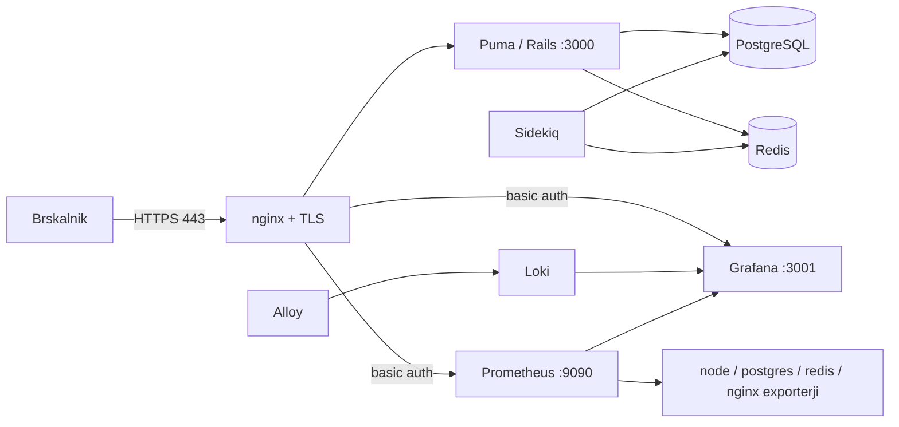

# Automated Rails Deployment With Vagrant

> Mapa `cloud-init/` vsebuje drugo različico (glej [cloud-init/README.md](cloud-init/README.md)).


## Arhitektura


# 1.Namen projekta

Cilj je bil da pokažemo kako lahko spletno aplikacijo deployamo varno in večktrat z uporabo samo enega ukaza na MAC-OS.
Za virtualko uporabimo Ubuntu 24.04 box in provision skripte ki:
  - Inštalira in konfigurira vsak servis, ki ga aplikacija potrebuje (PostgreSQL,Redis,Ruby,Puma,nginx)
  - Inštalira celoten monitoring in logging stack
  - Verificira da vse dela z avtomatiziranim "smoke test"
  - Uporabi različne varnostne mehanizme (HTTPS,protekcije pred brute force,firewall,SSH)
  - Celotna aplikacija se lahko izbriše/ustavi in ponovno zgradi
  - Skripte so varne, da jih ponovno zaženemo ter je vgrajena trajnost(podatki shranijo ob ponovnem zagonu - samo brez --provision)


# 2.Dodatne funkcionalnosti (bolj podrobno)

## Avtomatizacija

  - Oštevilčene modularne provizije 00-99,vsak lahko zaženemo posebej z vagrant provision --provision-with ime_provision
  - Ponovni zagon skript ne duplicira konfiguracije ali regenerira obstoječe skrivnosti/ključe
  - Vgrajen smoke-test. ki pregleda in testira provisioing, če je kaj narobe potem pade
  - Avtomatski sidekiq detekcija: če gemfile vsebuje sidekiq,"worker service" se kreira

## Varnost

  - **Network**: UFW firewall blokira ves vhodni promet razen na vratih 22,80,443,baze in monitoring; servisi poslušajo samo na localhost,fail2ban za SSH in nginx basic-auth
  - **SSH**: Root login disabled,max 4 poskusi,avtentikacijo samo z ključem
  - **Brute force zaščita**: fail2ban prepoveduje dostop za  sshd in nginx-http-auth(5 poskusov - 1 hour ban)
  - **Skrivnosti**: Naključno generirane na okolje;nikoli "hardcoded"(Baza,Redis,SECRET_KEY_BASE in admin gesla),shranjeni v /etc/myapp z omejenimi pravicami(root:deploy 640 env file,root 600 credentials file)
  - **TLS**: Ves zunanji promet iz HTTPS; HTTP preusmeri na HTTPS,2 načina mkcert(lokalno zaupan CA za development) in letsencrypt(pravi certifikati prek Cloudflare DNS challenge z auto-renewal hook)
  - **Kernel**: SYN cookies,reverse-path filtering in ICMP redirect protekcija prek sysctl
## Monitoring and Logging

  - Centraliziran logging z Loki in Grafana Alloy(journal in log shipping)
  - Prometheus z node,PostgreSQL,redis in nginx exporterji
  - Persistent journald z storage size cap
  - Grafana z "data sources" in 3 community dashboards, ki so avtomatsko provizionirani
  - **Grafana** vizualizira Prometheus(metrics) in Loki(logs).Provisioned dashboard Node Exporter FUll(1860),PostgreSQL(9628),Redis(11835)
  - **Exporters** izpostavi/razkrije metrike za komponente, ki to ne morejo same
  - **Alloy** zbira journal/dnevnik od systemd in loga datoteke in jih pošlje Loki.
  - **Promethueus** "scrapa" /metrics od vsakega exporterja vsakih 15s in shrani time series(7 dnevna shramba/zadrževanje)


  ## Komponente

| Komponenta | Vloga | Vrata | Poslušanje |
|---|---|---|---|
| nginx | reverse proxy, TLS, basic auth | 80, 443 | vsi vmesniki |
| Puma / Rails (`myapp`) | aplikacija | 3000 | 127.0.0.1 |
| Sidekiq (`myapp-sidekiq`) | ozadnji procesi (samo če je v Gemfile) | – | – |
| PostgreSQL | baza (scram-sha-256) | 5432 | localhost |
| Redis | cache/queue (geslo, 256 MB, volatile-lru) | 6379 | 127.0.0.1 |
| Prometheus | metrike, 7 dni hrambe | 9090 | 127.0.0.1 |
| Grafana | dashboardi | 3001 | 127.0.0.1 |
| Loki + Alloy | centralni logi (journal + datoteke) | 3100 | 127.0.0.1 |
| node / postgres / redis / nginx exporter | metrike komponent | 9100 / 9187 / 9121 / 9113 | 127.0.0.1 |

Zunaj VM sta dostopna samo **SSH (22)** in **nginx (80, 443)**. Vse ostalo je dostopno samo prek nginx z overjanjem.


## Backups

  - Vsakodnevni pg_dump prek systemd timerja,7 dnevnno zadržanje podatkov,ena varnostna kopija ustvarjena ob provisionu

## Prilagajanje virov

  - Redis memory cap in lru policy,Puma workers/threads konfigurirane prek env

## Testing

  **99-smoketest.sh provisioner teče avtomatsko in preveri**:
  - če so vsi od 13 servisev aktivnih
  - Grafana health prek nginx
  - PostgreSQL query in Redis overjen PING
  - HTTPS app(/up) in HTTP -> HTTPS redirect
  - Firewall je aktiven in varnostna kopija baze obstaja
  - Prometheus potrebuje avtentikacijo in pote lahko delamo z njo
  - All Prometheus targets up

# 3.Potrebe

  - macOS/Linux
  - Vagrant z Vagrant VMWare utility oz.VirtualBox
  - VMWare Fusion/Virtual box(opcijsko če boste uporabili Vagrant VMWare)
  - Vagrant in vagrant plugins(```vagrant plugin install vagrant-vmware-desktop```)
  - Dostop do interneta na prvem zagonu ter še dovolj CPU in RAM.

## Namestitev: izberi svoj scenarij

Najprej za vse scenarije:

```bash
git clone https://github.com/aneltoric123/sk-44-virtualization.git
cd sk-44-virtualization/vagrant
```

| Scenarij | Kje teče VM | Kje je brskalnik | Poglavje |
|---|---|---|---|
| **A** | Mac | isti Mac | [A](#a-mac-na-macu) |
| **B** | Linux | isti Linux | [B](#b-linux-na-linuxu) |
| **C** | oddaljen Linux (`devops-sk-44`) | tvoj Mac | [C](#c-oddaljen-linux-brskalnik-na-macu) |

V vseh scenarijih velja: **v `/etc/hosts` sme biti samo ena vrstica za `myapp.local`**. Staro najprej odstrani ali zamenjaj.

### A) Mac na Macu

```bash
vagrant up          # prvi zagon traja 10 - 15 min
```

Na koncu smoke test izpiše IP navideznega računalnika. Vnesi ga v hosts:

```bash
sudo sed -i '' '/myapp\.local/d' /etc/hosts
echo "<IP_VM>  myapp.local" | sudo tee -a /etc/hosts
```

(IP ponovno dobiš z `vagrant ssh -c "hostname -I"`; to je naslov iz privatnega omrežja, ne `10.0.2.15`.)

Zaupaj lokalnemu CA (ključavnica brez opozorila), nato ponovno zaženi brskalnik:

```bash
sudo security add-trusted-cert -d -r trustRoot \
  -k /Library/Keychains/System.keychain ./certs/rootCA.pem
``` 
Ta prejšnji dela sam na MACOS.
Odpri **https://myapp.local/**.

### B) Linux na Linuxu

Namesti Vagrant in hipervizor (Ubuntu 24.04: Vagrant ni v privzetih repozitorijih, uporabi HashiCorp apt repozitorij):

```bash
wget -O- https://apt.releases.hashicorp.com/gpg | sudo gpg --dearmor -o /usr/share/keyrings/hashicorp-archive-keyring.gpg
echo "deb [signed-by=/usr/share/keyrings/hashicorp-archive-keyring.gpg] https://apt.releases.hashicorp.com $(lsb_release -cs) main" | sudo tee /etc/apt/sources.list.d/hashicorp.list
sudo apt update && sudo apt install -y vagrant virtualbox
```

Zagon in hosts:

```bash
vagrant up
sudo sed -i '/myapp\.local/d' /etc/hosts
echo "<IP_VM>  myapp.local" | sudo tee -a /etc/hosts
```

Zaupanje CA (neobvezno, sicer v brskalniku sprejmi opozorilo):

```bash
# sistem (curl, ...)
sudo cp certs/rootCA.pem /usr/local/share/ca-certificates/myapp-rootCA.crt
sudo update-ca-certificates
# Chrome/Chromium
sudo apt install -y libnss3-tools
certutil -d sql:$HOME/.pki/nssdb -A -t "C,," -n myapp-mkcert -i certs/rootCA.pem
# Firefox: Settings → Privacy & Security → View Certificates → Authorities → Import
```

Odpri **https://myapp.local/**.

### C) Oddaljen Linux, brskalnik na Macu

VM teče na strežniku `devops-sk-44`, ki ga ne moremo doseči neposredno. Zato uporabimo preusmerjeni port (8443) in tunel prek Teleporta.

**1. Na strežniku** (spletni terminal), port ni privilegiran in VM je povezan na `127.0.0.1:8443`:

```bash
HTTPS_PORT=8443 vagrant up
curl -kI https://localhost:8443 -H "Host: myapp.local"     # pričakovano: HTTP/2 200
```

**2. Na Macu** (ne na strežniku), namesti odjemalca in se prijavi:

```bash
brew install --cask teleport
tsh login --proxy=devops.lrk.si --user=atoric
```

**3. Na Macu** odpri tunel in ga pusti odprtega:

```bash
tsh ssh -L 8443:localhost:8443 atoric@devops-sk-44
```

**4. Na Macu** (drugi terminal) preusmeri ime na tunel:

```bash
sudo sed -i '' '/myapp\.local/d' /etc/hosts
echo "127.0.0.1  myapp.local" | sudo tee -a /etc/hosts
```

**5. Zaupanje CA** (neobvezno): prenesi `rootCA.pem` na Mac in ga namesti, kot v scenariju A:

```bash
tsh scp atoric@devops-sk-44:~/<pot-do-repa>/vagrant/certs/rootCA.pem ~/Downloads/rootCA.pem
sudo security add-trusted-cert -d -r trustRoot -k /Library/Keychains/System.keychain ~/Downloads/rootCA.pem
```

Ukaz `security` obstaja samo na macOS. Odpri **https://myapp.local:8443/**.

### Pravi certifikat (Let's Encrypt)

Za veljaven certifikat brez nameščanja CA potrebuješ domeno v Cloudflare:

```bash
DOMAIN=moja.domena.si TLS_MODE=letsencrypt \
ACME_EMAIL=ime@mail.si CF_API_TOKEN=xxxx vagrant up
```
## Gremo na spletno stran

- **https://myapp.local/**
- **https://myapp.local/up** (Health check)
- **https://myapp.local/grafana/** (Grafana login podatki v terminalu)
- **https://myapp.local/prometheus/** (Prometheus login podatki v terminalu)

## Ostale Vagrant komande

- ``` vagrant halt ```(ustavi VM)
- ``` vagrant up ```(zažene Vm brez provisioning razen pri prvem zagonu)
- ``` vagrant ssh ``` (SSH od VM)
- ``` vagrant reload ```(ekvivalent če kličemo ```vagrant halt``` potem ``` vagrant up ```,provisinioning ne bo ponovno zagnan,zato moramo uporabiti --provision)
- ``` vagrant up --provision ```(zažene vse provisionarje)
- ``` vagrant destroy -f ```(ustavi/izbriše vagrant mašino ter še podatke oz.vire,ki so bili ustvarjeni med pospopkom ustvarjanja Vagrant)


## Struktura repozitorija

```
sk-44-virtualization/
├── README.md
├── vagrant/
│   ├── Vagrantfile
│   ├── myapp/            # Rails aplikacija
│   ├── config/           # nginx, prometheus, loki, alloy, grafana
│   ├── provision/        # 00-base … 99-smoketest, common.sh
│   └── certs/            # rootCA.pem (generira se ob provisioningu)
├── cloud-init/
└── slike/                  #posnetki zaslona
└── video/                 # video

```

# VAGRANT SLIKE IN POSNETKI


**Video postopka:** [/video/]
